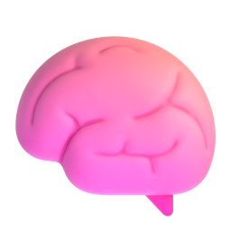
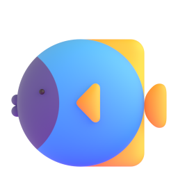
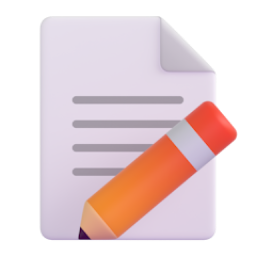
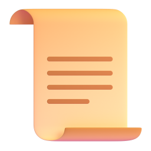
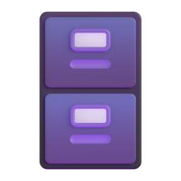

<div align="center">



# 测测你的上下文

**你的脑子现在是多少 K？**

大模型的上下文一满就得 compact，前面的内容被压成一句“之前我们聊了一些事”。<br>
最近你是不是也这样：看完就忘，刷完就空，说话越来越像“综上所述”？

<a href="https://feifei-121.github.io/context-test/"></a>


🔗 **https://feifei-121.github.io/context-test/**

</div>

---

## 🎯 这是什么

一个转给朋友玩的娱乐测试，仿照 MBTI 人格测试的形式，测的是你的**上下文窗口**：

- 🧠 **记忆**：昨天的晚饭、五分钟前读过的那段话，还在吗？
- 🎯 **专注**：屏幕上有东西在飘、手机在弹通知、倒计时在走，你还能看进去吗？
- ✂️ **概括**：能不能一句话说出重点，而不是“推进了多项工作”？
- 🗣️ **人味**：你说话还像人，还是开始自带“以下是三点建议”了？

> ⚠️ 温馨提示：有闪现题目哦，做好准备~

## 🏷️ 七种上下文人格

<table>
<tr>
<td align="center" width="14%"><br><b>−∞</b><br>幻觉体</td>
<td align="center" width="14%"><br><b>4K</b><br>金鱼型</td>
<td align="center" width="14%"><br><b>32K</b><br>便签型</td>
<td align="center" width="14%"><br><b>128K</b><br>标准版</td>
<td align="center" width="14%"><br><b>256K</b><br>长文本型</td>
<td align="center" width="14%"><br><b>1M</b><br>档案馆型</td>
<td align="center" width="14%"><br><b>+∞</b><br>人类原装</td>
</tr>
</table>

| 档位 | 人格 | 一句话诊断 |
| :---: | :--- | :--- |
| **−∞** | 😵‍💫 幻觉体 | 结果页大字：**魔了**。不只是记不住，是开始自己编 |
| **4K** | 🐠 金鱼型 | 聊三句就要 compact |
| **32K** | 📝 便签型 | 装得下一段对话，装不下一整天 |
| **128K** | 🧠 标准版 | 主流配置，偶尔掉帧 |
| **256K** | 📜 长文本型 | 能读完长文，还能说出重点 |
| **1M** | 🗄️ 档案馆型 | 吵架翻旧账时最可怕的那个 |
| **+∞** | 🌟 人类原装 | 结果页大字：**神了**。没有上限，也没有 AI 味（闪现题全对才能解锁） |

### 🔤 四位类型码

像 MBTI 一样，每个人还会拿到一个四位字母码，比如 `CDVA`、`RFSH`：

| 维度 | 高 | 低 |
| :---: | :---: | :---: |
| 记忆 | **R** 能回忆 | **C** 已压缩 |
| 专注 | **F** 专注 | **D** 分心 |
| 概括 | **S** 抓重点 | **V** 说空话 |
| 人味 | **H** 人话 | **A** AI 味 |

## ✨ 玩法亮点

| | |
| :--- | :--- |
| ⚡ **闪现阅读** | 一段文字或一组词只出现 5 到 6 秒，看完再答题 |
| 🔁 **回溯题** | 最后一题会突然问你前面某题的细节，测前文有没有被 compact 掉 |
| 🌀 **干扰模式** | 答题时屏幕上会飘过转圈的西瓜、汉堡和猫，顶部弹出假通知 |
| ⏱️ **每题 10 秒** | 顶部倒计时进度条，最后 3 秒变红，超时直接算你 compact 掉了 |
| 🔥 **热梗题** | 第一题就是最近很火的“画地为牢”，不过问题藏在一堆废话后面 |
| 🎰 **人格揭晓** | 档位数字滚动停下，人格图旋转出场 |
| 📋 **一键分享** | 复制结果时会带上链接，直接粘贴发给朋友 |

> 🤫 题目和答案就不在这里剧透了，自己去测。

## 🛠️ 技术

- 一个 `index.html` 文件，纯 HTML + CSS + JavaScript，没有框架，没有构建步骤
- 部署在 GitHub Pages，推送到 `main` 分支后自动上线
- 蓝白配色，支持手机竖屏和电脑浏览器，跟随系统切换深色（深海蓝）和浅色（天空白）
- 系统开启“减弱动态效果”时，干扰动画会自动关闭

### 本地运行

```bash
git clone https://github.com/feifei-121/context-test.git
cd context-test
open index.html        # macOS，或者直接双击 index.html
```

## 🎨 素材与版权

- 所有插图来自 [Microsoft Fluent Emoji](https://github.com/microsoft/fluentui-emoji)，MIT 许可，许可证原文见 [`img/LICENSE-fluent-emoji.txt`](img/LICENSE-fluent-emoji.txt)
- 字体：[ZCOOL KuaiLe](https://fonts.google.com/specimen/ZCOOL+KuaiLe)、[JetBrains Mono](https://fonts.google.com/specimen/JetBrains+Mono)，来自 Google Fonts，SIL Open Font License
- 题目里的“尼古拉斯·菲”纯属虚构，如有雷同，算你记性好

---

<div align="center">

**纯属娱乐 · 冬令时解药~** ❄️

测完记得转给那个回消息只回“嗯嗯”的朋友 👀

</div>
